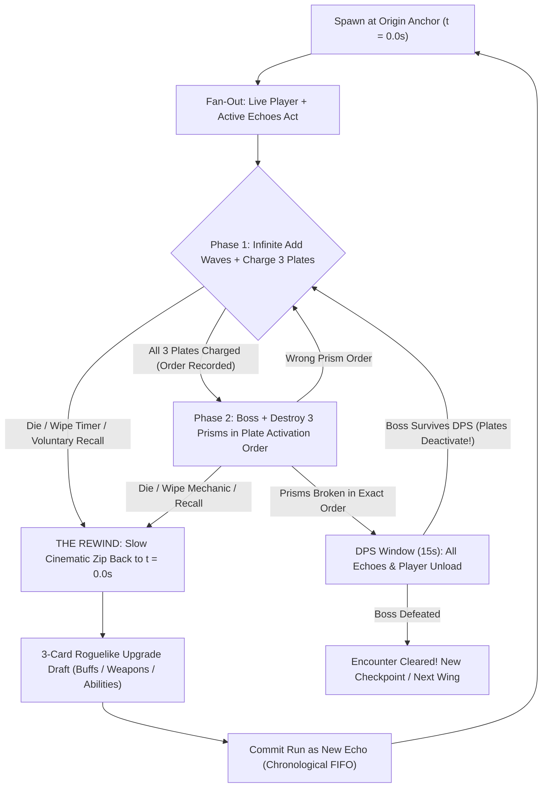

# CHRONOFIRE (Working Title) — Game Design & Technical Specification

> **Elevator Pitch:** A top-down 3D action game (stylized like *Skillshot City*) with *Destiny 2* raid-style encounter mechanics, built in **Rust** for **Desktop & Web (WASM)**. You play solo—because every time you die or rewind, time snaps back to the start of the encounter and a spectral **Echo** of your previous run spawns to strictly replay your exact actions. Die, adapt, and layer up to five past selves to become your own six-person raid fireteam.

---

## 1. Vision & Core Pillars

### 1.1 The Signature Moment: "The Snap & Fan-Out"
The emotional and visual centerpiece of the game happens on every failure or tactical reset:
1. **Fracture (0.25s):** Time freezes on death or wipe. A sharp harmonic chime rings out; chromatic aberration and radial fracture lines pulse from the player.
2. **The Rewind (2.4s–3.6s, eased):** The entire arena—enemies, projectiles, doors, puzzle progress, and every active Echo—zips smoothly backward in time along luminous ribbon trails, converging onto the **Origin Anchor** (spawn pad) at a luxurious pace so the player can savor the spectacle. Audio reverses into a rising pitch swell.
3. **The Snap (`t = 0.00s`):** Everything locks back into its pristine starting state. Your just-finished run crystallizes into a new spectral **Echo** standing shoulder-to-shoulder with you at the Anchor.
4. **The Fan-Out:** The instant you move, you and all your Echoes simultaneously peel away from the Origin Anchor in different directions—one sprinting left to hold a plate, one suppressing adds down mid, one grabbing a relic to the right—while you execute the missing piece of the puzzle.

### 1.2 Design Pillars
1. **Solo Raid Mastery:** Every encounter is designed around multi-role coordination (add-clear, plate holding, tethering, orb dunking, boss shield-break, synchronized DPS) that is impossible for one body alone, yet deeply solvable by layering your own past runs.
2. **Relentless Pressure:** Enemies spawn in infinite, deterministic waves until the map objective is completed. You never solve puzzles in a quiet room; you must survive incoming waves long enough to record reliable Echo runs, while layering past Echoes to suppress lanes for your future self.
3. **Zero-Friction Time Loops:** Rewinding must feel snappy, exhilarating, and tactical—not punishing. Players can deliberately trigger a **Temporal Recall** to "bank" a clean utility run, or **Discard** a botched run without polluting their fireteam.
4. **Readable Chaos:** With up to 6 player-avatars, projectiles, beams, and waves of enemies on screen, visual hierarchy (color-coded Echoes, clear ground telegraphs, crisp audio cues) is paramount.

---

## 2. Core Gameplay Loop



### 2.1 Encounter Structure (Single Seamless Timeline + Inter-Encounter Checkpoints)
Each level (a **Vault** or **Spire**) consists of 2–3 discrete **Encounters** separated by brief traversal corridors:
- **Single Seamless Timeline per Encounter:** Both Phase 1 (the Map Objective) and Phase 2 (the Boss Fight) run on **one continuous timeline** starting from `t = 0.00s` at the Origin Anchor. When you rewind—even during the Boss phase—the entire encounter rewinds to `t = 0.00s`. This maximizes the signature spectacle: by your final winning loop, your past Echoes fan out, rapidly unlock the Boss, break its shield, and converge with you for a synchronized finish.
- **Checkpoints Between Encounters:** Defeating an encounter's Boss (or completing a non-boss puzzle encounter) locks a hard checkpoint, clears previous Echoes, and establishes a new Origin Anchor for the next encounter arena.
- **Phase 1 — The Ritual (Map Goal + Infinite Waves):** Enemies pour from fixed spawn gates on a deterministic schedule. The player must complete a multi-part spatial puzzle (e.g., hold 3 synchronized plates, charge 3 conduits) to summon the Boss.
- **Phase 2 — The Boss (Puzzle -> DPS -> Repeat):** The Boss enters immune to direct damage. Players must solve a dynamic boss mechanic (e.g., break 3 rotating prisms within 4 seconds, or redirect a boss beam) to trigger a 15-second **Vulnerability (DPS) Window**.
- **Wipe Mechanics:** Certain phases have a clear environmental timer (e.g., *Eclipse Meter* filling over 90s) or a boss cast (*Supernova*) that kills the live player if uncountered—naturally triggering the Rewind.

---

## 3. Time-Loop & Echo Mechanics (The Temporal Ruleset)

Time-clone action games live or die on how they handle paradoxes and clutter. The following rules keep gameplay rock-solid, strategic, and free of frustrating softlocks.

### 3.1 The Fireteam Cap (Max 5 Echoes + 1 Live Player = 6)
- Inspired by 6-player raids, an encounter supports up to **5 active Echoes** alongside the live player.
- **Strict Chronological Order (FIFO):** Echoes always exist in strict chronological order without manual pinning. When all 5 slots are full, banking a new Echo cleanly shifts out the oldest Echo.
- **Voluntary Recall vs. Discard:**
  - **Press `R` (Temporal Recall):** Cleanly ends the current run, triggers the Rewind, saves this run as a new Echo, and opens the 3-card Upgrade Draft.
  - **Press `X` (Fracture Discard):** Rewinds immediately **without** saving the current run or drafting an upgrade (useful if you messed up in the first few seconds).

### 3.2 Strict Original-Timeline Echoes (Pure Deterministic Replay)
To keep time-loop planning 100% predictable, readable, and free of butterfly-effect frustration, Echoes follow **strict timeline purity**:
- **Exact Movement & Action Replay:** Echoes replay their exact recorded 3D transform (`x, y, z, yaw`), weapon fire, dashes, abilities, and interact channels on a fixed `60Hz` tick. If an Echo fired at `(12.0, 4.5)` at `t = 5.2s` in its original timeline, it fires at that exact spot and angle at `t = 5.2s` in every future timeline—even if no enemy is currently standing there.
- **Invulnerable to Current-Timeline Damage:** Echoes are untargetable, non-damageable temporal projections. Enemies cannot damage, stagger, or prematurely destroy an Echo, and enemy projectiles pass harmlessly through them (meaning enemy aggro focuses cleanly on the live player).
- **Exact Expiration (`T_end`):** An Echo remains active up to the exact tick `T_end` where the player died or triggered a Voluntary Recall in that Echo's original run. At `tick == T_end`, the Echo immediately shatters/dissipates in a burst of temporal sparks. There is no early death and no overtime extension—if you want an Echo to stay on a plate longer, you must survive longer on that plate during its recording run.
- **Relic / Orb Non-Conflict Rule:** Interactive pickups (Relics, Charges, Motes) dispense from pedestals on a per-entity basis (or as Phase-Copies for Echoes), ensuring the live player and an Echo never fight over or softlock a single physical orb.

### 3.3 Roguelike Upgrade Draft (Between Loops — *Vampire Survivors* / *Skillshot City* Style)
Rather than picking fixed classes, every Guardian begins with a crisp baseline kit (Pulse Rifle, Heavy Bolt, Dash). After each death or Voluntary Recall (immediately following the Rewind), time pauses at the Origin Anchor and presents **3 Upgrade Cards** (`Click` or press `1` / `2` / `3`). The chosen upgrade permanently empowers **all future lives** (while past Echoes retain the exact kit they were recorded with):
- **Stat Buffs:** *Chrono Haste* (+Move Speed & Dash CDR), *Overclocked Barrel* (+Fire Rate), *Solar Rounds* (+Damage), *Aegis Plating* (+Max HP), *Heavy Capacitor* (Heavy Bolt CDR & Damage).
- **Weapon Mods:** *Twin Split* (+1 angled projectile per shot, stackable), *Piercing Bolts* (+1 enemy pierce per shot).
- **Unlockable Abilities:**
  - **Aegis Dome (`[E]`):** Deploy a golden energy barrier that blocks enemy fire, protects against the Boss's *Temporal Nova*, and empowers allies/Echoes inside.
  - **Singularity Grenade (`[Q]`):** Launch a violet gravity well that pulls waves of enemies inward and detonates.
  - **Phase Blink (Upgrades `[Space]` Dash):** Enhances Dash into a long-range teleport blink with a post-blink speed surge.

### 3.4 Echo Visual & Audio Identity
- **Chronological Color Palette:** Live Player = crisp White/Gold; Echoes 1–5 = distinct luminous holographic hues (Cyan, Violet, Emerald, Amber, Rose) with subtle scanline/afterimage shaders and numbered overhead badges (`I`–`V`).
- **Intent Indicators:** Small diegetic icons above Echoes when performing key states (`[PLATE]`, `[TETHER]`, `[RELIC]`, `[SUPER]`) plus a circular fade-out ring showing remaining lifetime until `T_end`.
- **Rewind Ribbons:** During Rewind, each Echo leaves a glowing spline tracing its entire path back to the Origin Anchor, creating a striking spiderweb of light collapsing into a single point.

---

## 4. Player Controls & Combat Feel

### 4.1 Controls (Keyboard+Mouse / Gamepad)
| Action | Keyboard + Mouse | Gamepad |
|---|---|---|
| Move | `W A S D` | Left Stick |
| Aim | Mouse Cursor | Right Stick |
| Primary Fire | Left Click | `RT` |
| Heavy / Special Fire | Right Click | `LT` |
| Dash / Phase Blink | `Space` / `Shift` | `A` / `RB` |
| Aegis Dome (when unlocked) | `E` | `Y` |
| Singularity Grenade (when unlocked) | `Q` | `LB` |
| Temporal Recall (Save Echo & Rewind) | `R` | `B` |
| Discard Run (Rewind Without Saving) | `X` | `Select` |
| Draft Upgrade Card | Click / `1`–`3` | D-Pad + `A` |

### 4.2 Combat Tuning & Raid DPS Balance
- **Snappy Top-Down Feel:** 360° instant aiming, subtle camera look-ahead toward cursor, 2-frame hitstop on elite kills, clear enemy windup glows before attacks.
- **Infinite Wave Pacing:** Waves spawn on a deterministic timeline tied to encounter time `t` (e.g., `t = 5s`, `18s`, `32s`...). Because wave timing is deterministic per encounter seed, an Echo recorded clearing the `t = 18s` North Gate spawn will reliably intercept that exact wave on every subsequent loop!
- **Echo Damage Scaling:**
  - Against standard enemies (Adds): Echoes deal **75%** of live player damage (feels impactful and genuinely clears waves).
  - Against Bosses during DPS Windows: Echoes deal **50%** base damage, boosted to **85%** when standing inside a Bulwark's **Aegis Dome** or Arcanist's **Empowering Rift**. This rewards coordinating your past selves into a unified firing line during the DPS phase.

---

## 5. Enemy Roster (Vertical Slice Archetypes)

To keep implementation focused while delivering Destiny-style combat variety, start with **4 core enemy types** plus **1 Boss**:

1. **Swarmers (Thrall / Rusher):** Fast melee units spawned in packs of 5–8. Low HP; pressure players off plates and punish tunnel vision.
2. **Acolytes (Ranged Trooper):** Mid-range plasma bursts; take cover and lay down suppressing fire across lanes.
3. **Warden (Shielded Elite / Major):** High-HP heavy unit with a directional frontal shield and area-denial slam. Drops **Heavy Ammo** and **Phase Charges** needed for puzzles.
4. **Sniper / Weaver (Backline Threat):** Projects a bright laser sight for 1.5s before firing a high-damage piercing shot. Forces players to use cover, dashes, or an Echo's Aegis Dome.

---

## 6. Vertical Slice Encounter Design: *"The Sunken Orrery"*

This single-arena encounter proves the entire game loop, rewind spectacle, and Destiny-inspired puzzle/boss structure.

### 6.1 Arena Layout
```
                 [ NORTH GATE: Add Spawns ]
              +------------------------------+
              |        (Boss Altar)          |
              |           [ B ]              |
              |      /      |      \         |
  [WEST GATE] |  [Plate L]  |  [Plate R]     | [EAST GATE]
   Add Spawns |     (O)     |     (O)        |  Add Spawns
              |      \      |      /         |
              |       [Center Pillar]        |
              |             |                |
              |        [Plate S]             |
              |           (O)                |
              |             |                |
              |      [ORIGIN ANCHOR]         |
              +------------------------------+
```

### 6.2 Phase 1: Awakening the Orrery (Map Goal)
- **Objective:** Charge all **3 Resonance Plates** (`Plate L`, `Plate R`, `Plate S`) to `100%` **simultaneously** (each takes 8 seconds to charge while occupied; stepping off drains charge slowly).
- **Wipe Timer:** **75 seconds** (*"Orrery Collapse"*). If the seal isn't broken in time, the arena flashes gold and wipes.
- **How the Player Solves It Across Loops:**
  - *Loop 1 (Bulwark):* Sprint to `Plate L`, drop Aegis Dome, fend off West Gate Swarmers, hold plate for 25s -> **Recall**.
  - *Loop 2 (Arcanist):* Watch Echo #1 peel left to `Plate L`! Sprint to `Plate R`, clear East Gate Acolytes with Singularity Grenade, hold `Plate R` -> **Recall**.
  - *Loop 3 (Strider):* Watch Echo #1 and #2 fan out left and right! Sprint to `Plate S`—all three plates lock in simultaneously! The central seal shatters at `t = 18s`.

### 6.3 Phase 2: Boss — *Aurelion, The Chronophage*
Once all 3 Resonance Plates lock at `100%`, Aurelion materializes at `[ B ]` with an **Immune Solar Barrier** and three **Aegis Prisms** paired to the three plates (`West = L`, `North = S`, `East = R`).
- **Boss Attacks:** Rotating radial solar volleys targeting the live player while infinite waves continue to pour from the gates.
- **Ordered Shield-Break Puzzle:**
  - The 3 Aegis Prisms **must be destroyed in the exact chronological order that their corresponding Plates reached 100%** (e.g., if `Plate L` finished 1st, `Plate S` 2nd, and `Plate R` 3rd, you must shatter `Prism L → Prism S → Prism R`).
  - **Incorrect Order Penalty:** Destroying any Prism out of sequence immediately **deactivates all 3 Resonance Plates (`0%`)** and resets the Prisms, forcing you to re-charge the plates!
- **DPS Window (15 seconds):**
  - Breaking all 3 Prisms in the exact sequence shatters Aurelion's barrier for 15 seconds. All surviving Echoes + Live Player unload!
- **Post-DPS Full Puzzle Reset:**
  - If Aurelion survives the 15-second DPS window (or after surviving the 50% HP *Temporal Nova* wipe mechanic), Aurelion reforms its Immune Barrier and **all 3 Resonance Plates deactivate back to `0%`**. Players must repeat the full Plate → Ordered Prism puzzle loop to unlock the next DPS phase!

---

## 7. Technical Architecture (Rust + Bevy Implementation Blueprint)

### 7.1 Tech Stack & Build Targets
- **Language:** **Rust** (stable)
- **Engine:** **Bevy** (ECS-driven 3D engine with `wgpu` renderer)
- **Targets:**
  - **Desktop (Native):** Linux / Windows / macOS via Vulkan / DX12 / Metal.
  - **Web (WASM):** `wasm32-unknown-unknown` via `wasm-bindgen` + `trunk` (rendering via WebGPU with automatic WebGL2 fallback).
- **Why Rust + Bevy Fits This Game:**
  - Native `FixedUpdate` schedule (`60Hz`) cleanly decouples deterministic simulation ticks from variable-framerate rendering.
  - ECS architecture maps naturally to `Player`, `Echo`, `Projectile`, `Plate`, and `Rewindable` components.
  - Custom **WGSL** materials/shaders work identically across Desktop and WASM for holographic Echo silhouettes, rewind trail ribbons, and time-fracture post-processing.

### 7.2 Simulation & ECS Architecture
The golden rule: **Separate Simulation State (`FixedUpdate` at `60Hz`) from Visual Presentation (`Update`)**, driven by an integer `EncounterClock.tick: u32`.

```
Bevy App / EncounterPlugin
 ├── Resources
 │    ├── EncounterClock { tick: u32, mode: Live | Rewinding | Paused, rewind_t: f32 }
 │    ├── EncounterRng (seeded ChaCha8Rng, reset to encounter_seed on t = 0)
 │    ├── ActiveRecorder (Vec<EchoFrame> for the live player)
 │    ├── EchoRoster (up to 5 EchoTrack slots + pinned flags)
 │    └── VisualHistoryBuffer (ring buffer of 30Hz enemy/puzzle snapshots for rewind VFX)
 ├── Systems (FixedUpdate @ 60Hz, run_if(Live))
 │    ├── player_input_and_movement (3D XZ plane + ground raycast aim)
 │    ├── record_live_player_frame
 │    ├── replay_echo_tracks (sets exact Transform + fires actions on rising edges, despawns at T_end)
 │    ├── wave_director_system (deterministic spawns from (tick, seed))
 │    ├── combat_and_projectile_system (Echoes excluded from enemy damage/targeting)
 │    └── puzzle_and_boss_state_machine
 └── Systems (Update, run_if(Rewinding))
      ├── advance_rewind_cursor (smoothstep ease from T_current -> 0 over 1.5s)
      ├── scrub_echo_and_player_ribbons (3D mesh trail strips converging on Origin Anchor)
      ├── scrub_enemy_visual_history (enemies zip back into spawn gates)
      └── snap_and_reset_encounter (at t = 0: commit EchoTrack, reset RNG/world, enter Live)
```

### 7.3 Recording & Replay Data Model
Recording state keyframes at `60Hz` is compact, cache-friendly, and guarantees zero physics-drift from the Echo's original timeline:

```rust
#[repr(C)]
#[derive(Clone, Copy, Debug)]
pub struct EchoFrame {
    pub tick: u32,           // 4 bytes — exact 60Hz simulation tick
    pub pos: [f32; 3],       // 12 bytes — 3D world position (x, y, z)
    pub yaw: f32,            // 4 bytes — facing / aim yaw in radians
    pub action_flags: u16,   // 2 bytes — bitmask: PRIMARY, HEAVY, DASH, ABILITY, INTERACT
    pub state: u8,           // 1 byte — IDLE, RUN, DASHING, DEAD, RECALLED
    pub _pad: u8,            // 1 byte — alignment
} // 24 bytes per frame

pub struct EchoTrack {
    pub id: u64,
    pub archetype: Archetype,
    pub color_slot: u8,      // 0..5 holographic hue
    pub pinned: bool,
    pub end_tick: u32,       // exact tick of death or recall
    pub frames: Vec<EchoFrame>,
}
```
- **Memory Budget:** A 2-minute run at `60Hz` = `7,200 frames × 24 bytes` = **~172 KB per Echo**. Five active Echoes use **< 0.9 MB total RAM**—trivial even under WASM's memory constraints.
- **Action Triggering:** On tick `t`, each `Echo` entity sets its `Transform` directly from `track.frames[t]`, and checks rising edges in `action_flags` (e.g., `PRIMARY` triggered on tick `t` spawns an Echo projectile at `pos` along `yaw`, regardless of whether an enemy is currently there). When `t >= track.end_tick`, the Echo plays its shatter VFX and despawns.

### 7.4 The Rewind Visual Pipeline (3D)
To achieve the signature *Rewind & Fan-Out* feel without needing to reverse-simulate physics:
1. **Visual History Buffer (30Hz):** Every 2nd tick during `Live`, record lightweight `(entity_id, Vec3, yaw)` snapshots of active enemies and puzzle charge percentages.
2. **Rewind State (`mode = Rewinding`):**
   - Pause all `FixedUpdate` gameplay systems (no collisions, no damage, no spawns).
   - Advance a rewind cursor `t_cursor` from `T_current` down to `0` over `1.5 seconds` using a `smoothstep` easing curve, so rewind starts crisp, accelerates through the middle, and snaps cleanly into `t = 0`.
   - Each Echo and the just-finished Player scrub backward through their `EchoTrack.frames[t_cursor]`, extruding a glowing 3D **Ribbon Mesh** back toward the Origin Anchor.
   - Enemies zip backward along `VisualHistoryBuffer` back into their spawn gates and dissolve.
   - Puzzle plate rings and Boss shield VFX visually drain back to `0%`.
3. **The Snap (`t_cursor == 0`):**
   - Reset `EncounterRng` to `encounter_seed` and despawn transient entities (enemies, projectiles).
   - Commit `ActiveRecorder` into `EchoRoster` as a new `EchoTrack` (evicting oldest unpinned if at 5, or discarding if `Discard` was pressed).
   - Trigger 0.15s freeze-frame + 3D radial shockwave shader pulse + chime -> enter `Live` mode and Fan-Out!

---

## 8. Audio & Visual Direction (Top-Down 3D — *Skillshot City* Inspired)

- **Camera & Perspective:** High-angle top-down 3D perspective camera (~50°–60° pitch, low FOV ~35°–40° to reduce edge distortion while preserving crisp 3D depth, verticality, and readable skillshot geometry), with subtle cursor look-ahead and smooth zoom-out during the Rewind so the entire arena's ribbons are visible at once.
- **Stylized 3D Look (*Skillshot City* Inspiration):**
  - Clean, readable **stylized low-poly / cel-shaded 3D geometry** with bold silhouettes, emissive trim, and crisp ground-projected decals/telegraphs (plate charge rings, sniper lasers, mortar impact circles, boss beam paths).
  - High-contrast arena palette (deep slate/obsidian stonework with warm celestial brass accents) so vibrant skillshots, ability AoEs, and neon holographic Echoes pop effortlessly in frantic 6-character firefights.
  - **Custom WGSL Echo Material:** Semi-transparent Fresnel rim-lit hologram shader with subtle vertical scanlines and per-slot neon tint (Cyan, Violet, Emerald, Amber, Rose) so Echoes are immediately distinguishable from the solid-shaded Live Player.
- **Audio Feedback (Crucial for Raid Awareness):**
  - Distinct musical chord progression as Plates lock in (Plate 1 = C, Plate 2 = E, Plate 3 = G -> Boss Spawn brass hit!).
  - **Rewind Audio:** Brief tape-stop -> rising pitch-swept reverse synth -> crisp mechanical clock-chime at `t = 0`.
  - Subtle volume attenuation on Echo gunfire so 5 firing Echoes feel empowering without drowning out enemy telegraphs or the live player's own shots.

---

## 9. Phased Implementation Roadmap

### Phase 1: Rust/Bevy Project Setup & Time-Loop Sandbox (Core Feel Proof)
- Cargo workspace targeting both Native Desktop and `wasm32-unknown-unknown` (verified with `trunk serve`).
- Top-down 3D arena blockout, angled camera with cursor look-ahead, and 3D player controller (WASD movement, ground-plane raycast aiming, projectile shooting, dash).
- `FixedUpdate` (`60Hz`) `EncounterClock`, `ActiveRecorder`, and `EchoRoster` (up to 5 strict-timeline Echoes).
- **The Rewind & Fan-Out VFX:** Reverse scrubbing, 3D glowing trail ribbons converging on the Origin Anchor, Snap shockwave, and simultaneous fan-out.
- 3 synchronized test plates to validate multi-Echo puzzle feel.

### Phase 2: Combat, Infinite Waves & Fireteam Loadouts
- Deterministic `WaveDirector` + 4 stylized 3D enemy archetypes (Swarmer, Acolyte, Warden, Sniper) with ground telegraphs.
- Live player health, death -> auto-rewind, Voluntary Recall (`R`), Discard (`X`), and Echo Pinning (`1–5`).
- 3 Archetype loadouts (*Bulwark*, *Strider*, *Arcanist*) switchable between loops.

### Phase 3: "The Sunken Orrery" Boss Encounter (Vertical Slice)
- Full 3D arena layout with cover pillars, spawn gates, 3 Resonance Plates, and Boss Altar.
- Single seamless timeline transitioning from Phase 1 (Plates + Wipe Timer) into Phase 2 (*Aurelion, The Chronophage*: Immune Shield, 3 synchronized Aegis Prisms, DPS Window, 50% HP *Temporal Nova*).
- HUD: Timeline scrubber bar (showing each Echo's `T_end` lifespan & pin status), Wipe Timer, Boss HP + phase pips.

### Phase 4: Polish, Shaders & Content Expansion
- WGSL holographic Echo shaders, hitstop, camera shake, rewind chromatic-aberration post-process, and audio reverse-sweep.
- Playtesting & tuning of Echo damage multipliers, wipe timers, and wave density on both Desktop and Web (WASM).
- Additional encounters with inter-encounter checkpoints: Tether/Conduit relay room, Relic-Dunking vault, and multi-phase Final Raid Boss.

---

## 10. Locked Architectural & Design Decisions

| Decision | Choice | Rationale |
|---|---|---|
| **Language & Engine** | **Rust + Bevy** | Single codebase compiling cleanly to Native Desktop and Web (WASM) with built-in 60Hz `FixedUpdate` ECS and WGSL shaders. |
| **Visual Perspective** | **Top-Down 3D (*Skillshot City* style)** | Bold, stylized 3D silhouettes with crisp ground telegraphs, readable skillshots, and dramatic 3D rewind ribbons. |
| **Echo Simulation** | **Strict Original Timeline** | Echoes replay exact recorded positions/shots/abilities, take no damage from enemies, and expire at their exact original `T_end`—100% predictable puzzle execution. |
| **Progression & Buildcraft** | **3-Card Roguelike Draft After Death/Recall** | Replaces fixed classes with *Vampire Survivors* / *Skillshot City*-style 3-card upgrade choices (stat buffs, weapon mods, and unlockable abilities) that permanently empower all future lives. |
| **Echo Management** | **Strict Chronological FIFO (No Pinning)** | Up to 5 Echoes always exist in pure chronological order, keeping the fireteam HUD clean and freeing `1–3` hotkeys for upgrade drafting. |
